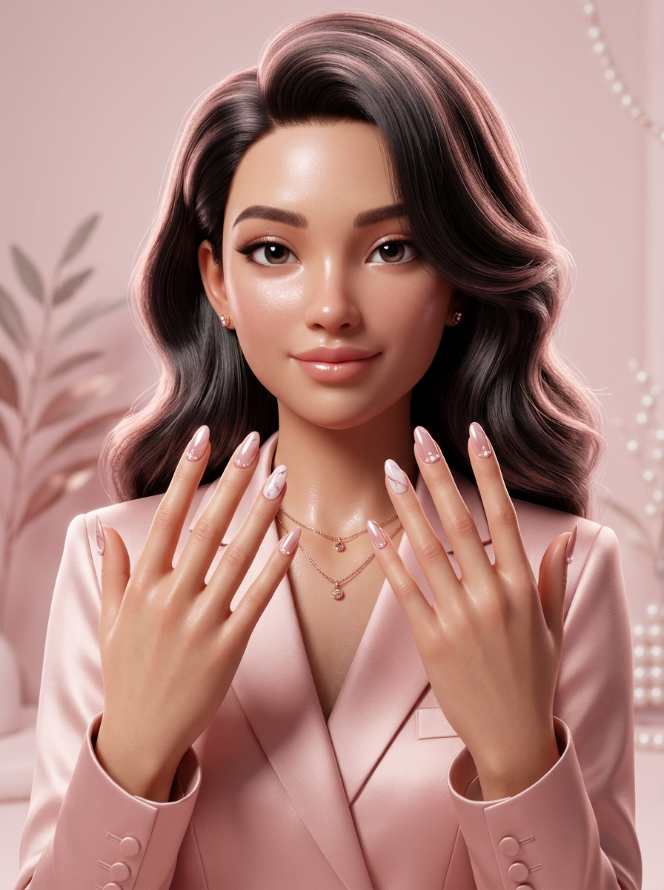
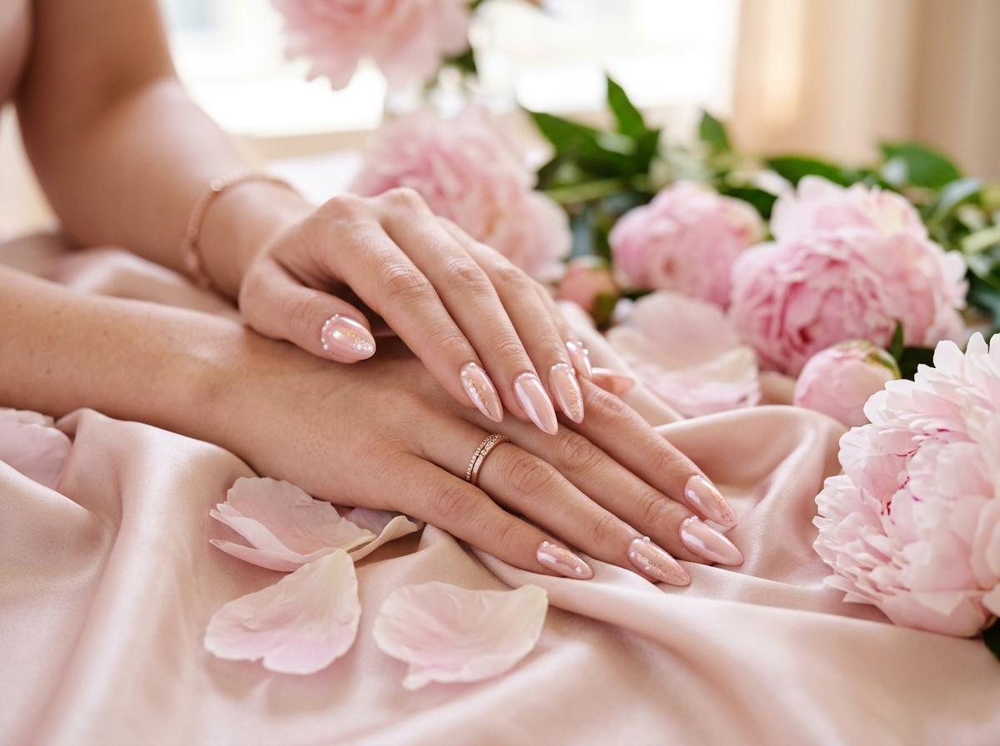
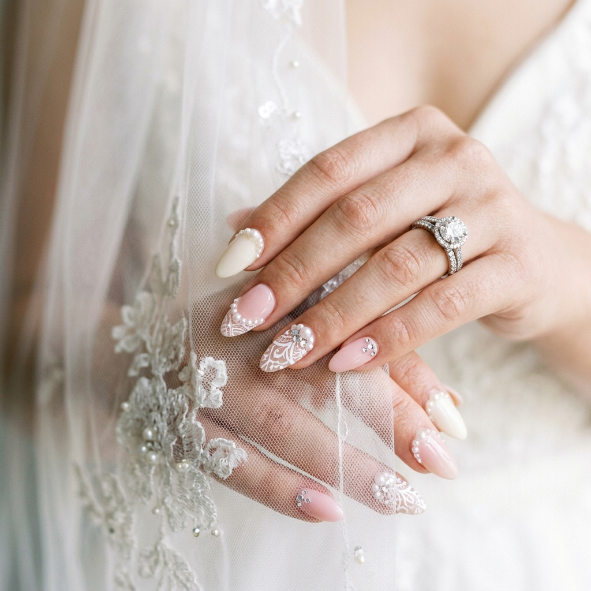
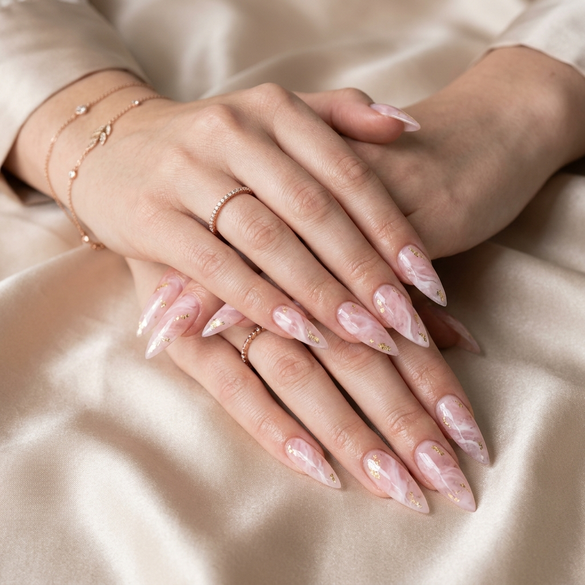
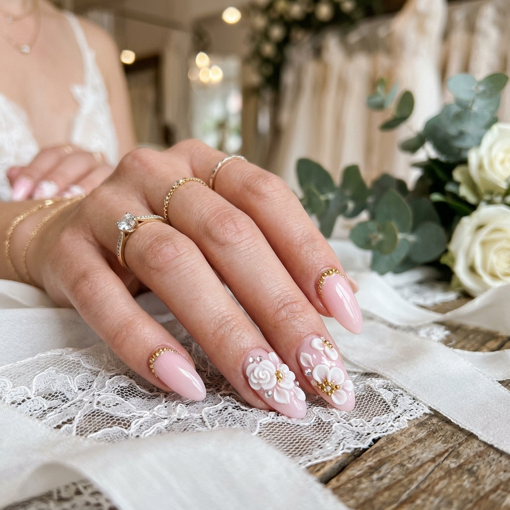
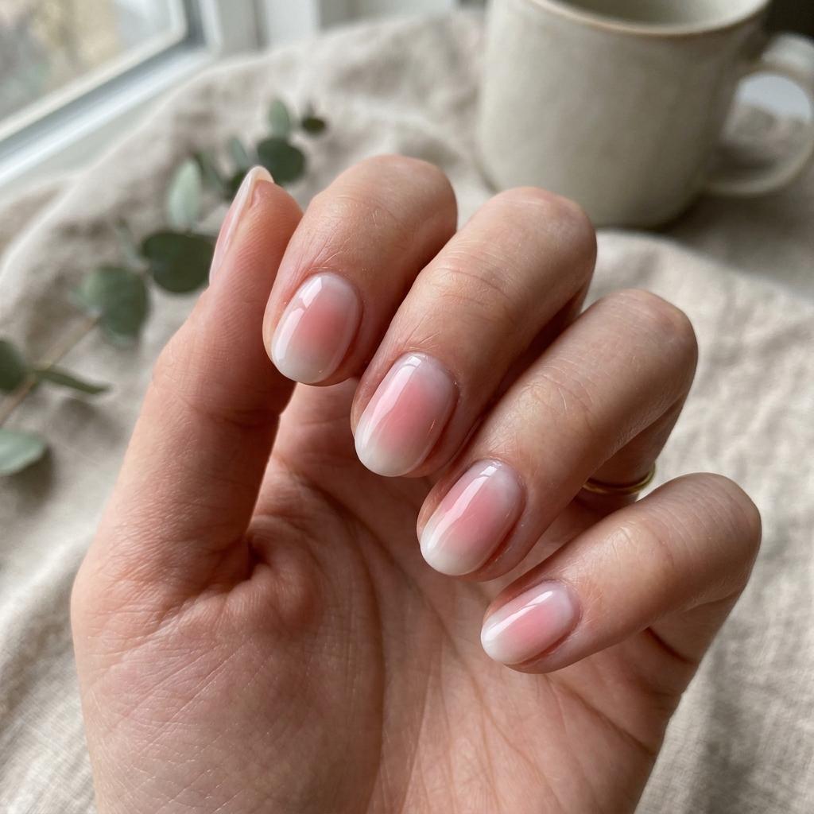
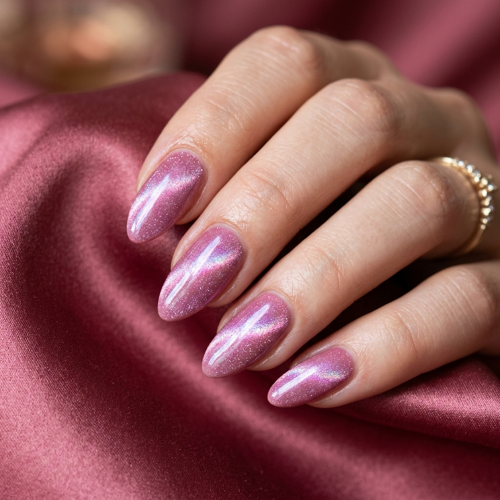
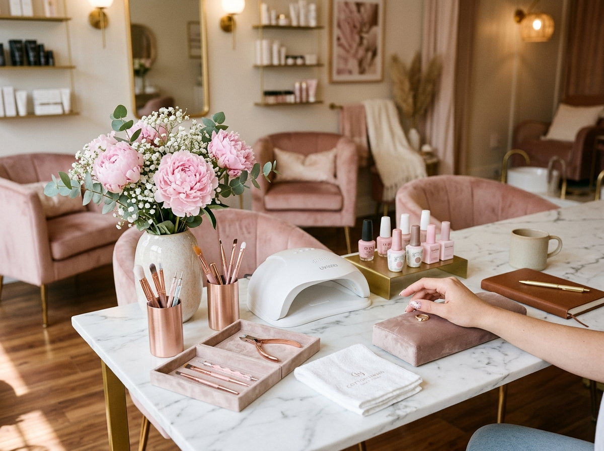
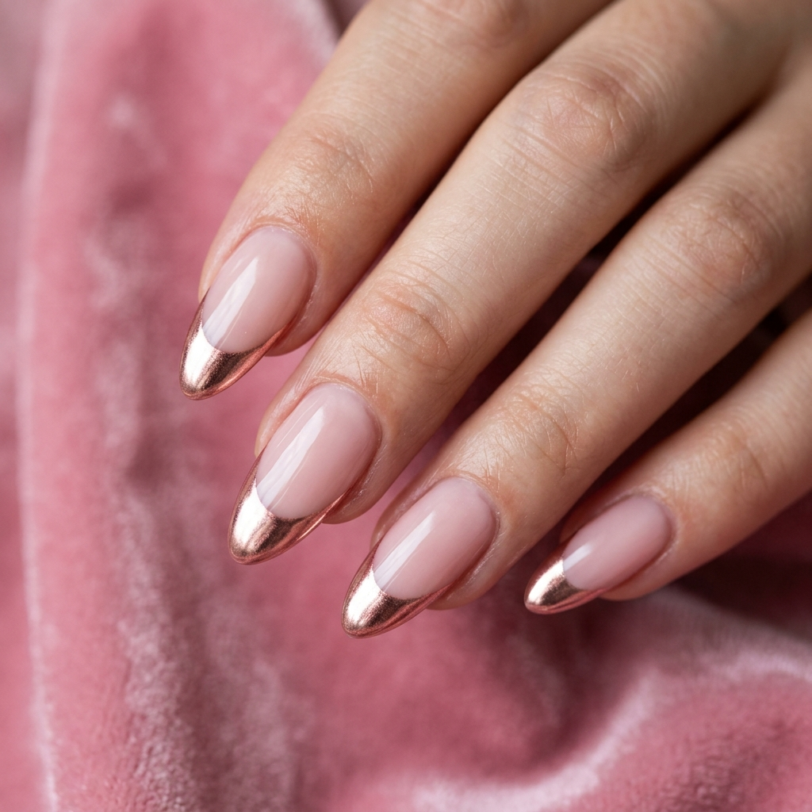

# 💅 Nails by Sanu

<div align="center">

  <p align="center">
    
  </p>

  <h3 align="center"><em>“Where Beauty Meets Art.”</em></h3>

  <p align="center">
    <strong>A bespoke digital atelier celebrating haute nail artistry, couture aesthetics, and seamless appointment booking.</strong>
  </p>

  <p align="center">
    <a href="https://nailsbysanu.netlify.app/"><strong>✨ Live Website</strong></a> •
    <a href="#-project-overview">Overview</a> •
    <a href="#-key-features">Key Features</a> •
    <a href="#-visual-showcase">Showcase</a> •
    <a href="#-technology-stack">Tech Stack</a> •
    <a href="#-website-architecture">Architecture</a> •
    <a href="#-installation--local-development">Getting Started</a> •
    <a href="#-developer--credits">Credits</a>
  </p>

  <!-- Luxury Badges -->
  <p align="center">
    <a href="https://nailsbysanu.netlify.app/"></a>
    
    
    
    
    
    
    
    
  </p>

</div>

---

## 🌐 Live Website

> [!TIP]
> **Experience the Live Atelier:** [https://nailsbysanu.netlify.app/](https://nailsbysanu.netlify.app/)
> 
> Explore the 3D cinematic avatar, 360° cylindrical nail design gallery, "What Is Your Nail Aesthetic?" interactive quiz, and direct WhatsApp / Instagram booking flow live in your browser.
> 
> - **Live URL:** [https://nailsbysanu.netlify.app/](https://nailsbysanu.netlify.app/)
> - **Source Repository:** [https://github.com/aryannikam028/Nail-Artist](https://github.com/aryannikam028/Nail-Artist)

---

## 🌸 Project Overview

**Nails by Sanu** is an editorial-grade, luxury digital destination created for **Sanu**, an independent nail artist based in Satara, Maharashtra. Crafted with a philosophy of refined minimalism and feminine elegance, the platform transforms the traditional salon booking process into an immersive visual and sensory journey.

From hand-painted bridal lace to chrome mirror glazes and Korean aura gels, the website functions as a high-fashion portfolio and digital concierge. It bridges fine craftsmanship with cutting-edge web technologies—merging **Three.js WebGL 3D environments**, **physics-driven interactive carousels**, and **direct WhatsApp / Instagram booking channels** to deliver a friction-free client experience.

### ✨ The Brand Experience
* **Palette:** Soft Blush Pink (`#F8C8DC`), Nude Champagne (`#F5E6D3`), and Metallic Rose Gold (`#B76E79`) balanced over Pearl White (`#FFF9FC`) with Deep Burgundy (`#57243B`) editorial typography.
* **Typography:** Haute couture serif titles using *Playfair Display* & *Cinzel*, paired with ultra-clean modern sans-serif *Plus Jakarta Sans* and handwritten *MonteCarlo* script accents.
* **Atmosphere:** Glassmorphic translucent cards, delicate radial glow gradients, subtle floating particle physics, and cinematic transitions.

---

## 💎 Key Features

Each feature within **Nails by Sanu** has been purposefully engineered to reflect the precision and luxury of high-end salon artistry:

### 1. 🌟 Interactive 3D Avatar & Cinematic Studio
* **Three.js WebGL Canvas:** Custom WebGL lighting and high-performance renderer supporting realistic studio lighting (ambient, directional, and point rim lights).
* **Bone-Rigged 3D Avatar:** Powered by Ready Player Me and Avaturn GLB models with inverse kinematics and bone manipulation (head, neck, spine, arms, and wrists).
* **FBX Animation Mixing:** Integrated animation state manager coordinating multiple clips including `showcase`, `gesture`, `dance`, and natural breathing `idle` loops.
* **Voice-Synchronized Lip-Sync:** Edge-TTS neural speech synthesis (`en-US-AvaNeural`) with word-boundary JSON timestamps driving facial morph targets for authentic voice greetings.

### 2. 🎠 360° Curved 3D Cylindrical Gallery
* **Mathematical 3D Cylindrical Projection:** Custom CSS 3D matrix calculating dynamic radii, chord angles, and z-depth transforms based on viewport width.
* **Dual Viewing Modes:** Seamlessly switch between the **3D Cylinder Carousel** (with drag-to-spin physics, auto-rotation, and interactive hover depth) and the **Responsive Grid View**.
* **12 Curated Style Categories:**
  * *Pink Luxury Nails*
  * *French Nail Art*
  * *Bridal Nails*
  * *Glitter & Glam*
  * *Chrome Nails*
  * *Minimalist Nails*
  * *Cute & Girly Nails*
  * *Floral Nail Art*
  * *Korean Nail Art*
  * *3D Nail Art*
  * *Nail Extensions*
  * *Trending Designs*

### 3. 🎴 Arched Card Fan Services Showcase
* **Radial Transform Geometry:** Services are presented in an elegant fanned deck layout where cards calculate non-linear rotational offsets, horizontal translations, and vertical arcs.
* **Interactive Deck Navigation:** Drag-to-scrub gesture control, auto-cycling interval with pause-on-hover, and direct booking modal triggers for each salon service:
  1. *Gel Polish & Overlay*
  2. *Nail Extensions & Sculpting*
  3. *Modern French & Chrome Art*
  4. *Bridal Couture Nails*
  5. *Custom & 3D Nail Art*

### 4. 🔮 "What Is Your Nail Aesthetic?" Style Finder
* **Interactive Persona Matching:** An aesthetic discovery tool helping clients explore their personal vibe across 8 curated design archetypes:
  * **Soft Girl:** Dewy syrup gels and translucent blush aura gradients.
  * **Pink Princess:** Romantic floral 3D petals and fairytale shimmer.
  * **Minimal Chic:** Milky sheer bases with razor-thin metallic rose gold accents.
  * **Bridal Elegance:** Intricate lace patterns, champagne ombré, and micro pearls.
  * **Glam Queen:** High-voltage glitter ombré and prismatic Swarovski crystals.
  * **Chrome Obsession:** Liquid mirror glazed shine and velvet magnetic cat-eye depth.
  * **Cute & Playful:** 3D sculpted bows, jelly hearts, and pastel charms.
  * **Luxury Diva:** Opulent marble extensions crowned with gold leaf foil.
* **Instant Booking Action:** One-click conversion generating tailored consultation messages for the selected aesthetic.

### 5. 💌 Dual-Channel Appointment Booking Modal
* **WhatsApp Deep-Linking:** Formulates pre-encoded, structured appointment requests sent directly to Sanu's studio WhatsApp (`+91 9359387837`).
* **Instagram DM Integration:** Pre-formats personalized consultation requests ready for instant copying and direct routing to `@nailsbysanu_18`.
* **Smart Form Controls:** Allows clients to specify their preferred design, service type, requested date, and preferred time slot (Morning, Afternoon, Evening).
* **Confetti Celebration:** Triggers an animated celebratory particle burst upon inquiry submission powered by `canvas-confetti`.

### 6. 🔍 High-Resolution Lightbox & Studio Media
* **Full-Resolution Viewer:** Modal lightbox supporting image zooming, keyboard navigation (`Esc`, `←`, `→`), and direct design booking.
* **Curated Studio Video:** Autoplaying editorial hero video showcase with intelligent audio-unlock gesture handling.
* **Floating WhatsApp Concierge:** Persistent quick-contact widget with animated reminder pill and direct messaging link.

---

## 📸 Visual Showcase

A glimpse into the authentic design assets and artistry curated within the project:

| Glazed Blush Chrome | Bridal Pearl Couture | Rose Quartz Extensions |
| :---: | :---: | :---: |
|  |  |  |
| *Signature Glazed Blush Chrome* | *Handcrafted Bridal Lace & Pearls* | *Sculpted Stiletto Extensions* |

| Sculpted 3D Floral | Korean Aura Gels | Velvet Magnetic Cat-Eye |
| :---: | :---: | :---: |
|  |  |  |
| *3D Sculpted Peony Petals* | *Dewy Syrup Korean Aura Gradient* | *Prismatic Holographic Cat-Eye* |

| Studio Workspace | 3D Studio Avatar | French Chrome Tips |
| :---: | :---: | :---: |
|  |  |  |
| *Satara Studio Workspace* | *Sanu's 3D Interactive Avatar* | *Rose Gold Metallic French Tips* |

---

## 🎨 Luxury Design Tokens

The visual identity is governed by an intentional design system built with custom CSS variables and Tailwind tokens:

### Color Palette
| Token | Hex | Swatch | Purpose |
| :--- | :--- | :---: | :--- |
| `blush-300` | `#F8C8DC` |  | Primary blush brand tint, glow rings, borders |
| `blush-500` | `#EFA6C8` |  | Soft rose accent, button gradients, hover badges |
| `rosegold` | `#B76E79` |  | Signature metallic rose gold, icons, highlights |
| `burgundy` | `#57243B` |  | Editorial typography, deep contrast headings |
| `pearl` | `#FFF9FC` |  | Luminous canvas background, clean containers |
| `champagne` | `#F5E6D3` |  | Warm neutral accents, secondary card fills |

### Haute Couture Typography
* **Serif Headings:** `Playfair Display` & `Cinzel` — classic elegance, high-fashion editorial presence.
* **Body & UI:** `Plus Jakarta Sans` — ultra-legible, modern geometric proportions.
* **Script Accents:** `MonteCarlo` & `Great Vibes` — personal artisan signature touch.

---

## 🛠️ Technology Stack

| Layer | Technologies | Purpose |
| :--- | :--- | :--- |
| **Core Framework** | **React 19** (`v19.3.1`), **React DOM** | Component-driven architecture and state management |
| **Language** | **TypeScript 5/7** (`~v7.0.2`) | Strict typing, brand interface models, compile-time safety |
| **Build Engine** | **Vite 8** (`v8.3.5`) | Ultra-fast Hot Module Replacement (HMR) and optimized bundling |
| **Styling & Design** | **Tailwind CSS 3.4**, **PostCSS**, **Autoprefixer** | Custom luxury color tokens, glassmorphism, responsive utilities |
| **3D & WebGL** | **Three.js** (`v0.186.1`), GLTFLoader, FBXLoader | 3D avatar rendering, studio lighting, bone rigs & animations |
| **Animation & Physics** | **Framer Motion** (`v14.7.1`), **GSAP** (`v3.15.0`) | Smooth layout spring animations, timeline camera sequences |
| **Iconography** | **Lucide React** (`v1.62.0`) | Clean, modern vector icons matching luxury aesthetics |
| **Interactive FX** | **Canvas Confetti** (`v1.9.4`) | High-performance particle bursts upon appointment submission |
| **Voice Synthesis** | **Edge TTS** (`edge-tts` Python engine) | Neural voice greeting generation with word boundary lip-sync |
| **Code Quality** | **Oxlint** (`v1.89.0`) | High-speed Rust-based JavaScript and TypeScript linting |

---

## 🏛️ Website Architecture

```
Nail-Artist/
├── public/
│   ├── audio/
│   │   ├── greeting.mp3           # Neural Ava voice greeting audio
│   │   ├── greeting.vtt           # Subtitle timing tracks
│   │   └── greeting_timings.json  # Word boundary timestamps for 3D lip-sync
│   ├── images/
│   │   ├── artist-workspace.jpg   # Studio workspace photography
│   │   ├── bridal-pearl.jpg       # Bridal nail art photography
│   │   ├── cat-eye-velvet.jpg     # Magnetic cat-eye photography
│   │   ├── cute-girly.jpg         # 3D ribbons & charms photography
│   │   ├── extensions-marble.jpg  # Sculpted extensions photography
│   │   ├── floral-3d.jpg          # 3D floral sculpting photography
│   │   ├── french-chrome.jpg      # Chrome French tips photography
│   │   ├── glitter-glam.jpg       # Glitter ombré photography
│   │   ├── hero-nail-art.jpg      # Glazed blush chrome hero photography
│   │   ├── korean-aura.jpg        # Korean jelly aura photography
│   │   ├── luxury-polish-bottle.jpg # Floating lacquer 3D element
│   │   ├── minimalist-chic.jpg    # Minimal fine-line photography
│   │   └── sanu-3d-avatar.jpg     # 3D avatar portrait of Sanu
│   ├── models/
│   │   ├── avaturn.glb            # Rigged 3D avatar model
│   │   ├── readyplayer.me.glb     # Auxiliary 3D avatar model
│   │   ├── TranThiNgocTham.glb    # Studio 3D model
│   │   └── *.fbx                  # Animation clips (dance, gesture, idle, showcase)
│   └── videos/
│       └── hero-video.mp4         # Studio hero highlight reel
├── src/
│   ├── assets/                    # Static SVG and branding assets
│   ├── components/
│   │   ├── icons/
│   │   │   └── InstagramIcon.tsx  # Custom SVG vector Instagram mark
│   │   ├── three/
│   │   │   ├── Cinematic3DStudio.tsx # Three.js WebGL studio, avatar & lip-sync engine
│   │   │   └── Hero3DCanvas.tsx      # Ambient Three.js hero canvas
│   │   ├── AboutSanu.tsx          # Artist bio, studio workspace & craftsmanship story
│   │   ├── AestheticSelector.tsx  # "What Is Your Nail Aesthetic?" interactive finder
│   │   ├── BookingModal.tsx       # Dual WhatsApp / Instagram appointment booking modal
│   │   ├── CardFanCarousel.tsx    # Math-driven arched radial services fan carousel
│   │   ├── ContactSection.tsx     # Direct consultation links & studio details
│   │   ├── Curved3DCarousel.tsx   # 360° cylindrical 3D nail gallery carousel
│   │   ├── FloatingDecorations.tsx # Ambient luxury background glows & particles
│   │   ├── FloatingWhatsApp.tsx   # Persistent floating WhatsApp consultation widget
│   │   ├── Footer.tsx             # Studio branding, navigation & credit links
│   │   ├── Gallery.tsx            # Main portfolio gallery with category filter & dual views
│   │   ├── Hero.tsx               # Editorial hero section with video showcase & actions
│   │   ├── InstagramShowcase.tsx  # Social grid feed linking to @nailsbysanu_18
│   │   ├── Lightbox.tsx           # Fullscreen modal image viewer with navigation
│   │   ├── Navbar.tsx             # Glassmorphic responsive sticky navigation
│   │   └── Services.tsx           # Salon service menu section container
│   ├── data/
│   │   └── brandConfig.ts         # Centralized studio configuration (services, designs, WhatsApp)
│   ├── App.css                    # Component utilities and custom styling
│   ├── App.tsx                    # Root application component orchestrating sections
│   ├── index.css                  # Global Tailwind layers, scrollbars & theme tokens
│   └── main.tsx                   # React 19 application entry point
├── generate_voice.py              # Edge-TTS script generating voice & lip-sync timings
├── index.html                     # HTML5 shell with Google Fonts & OpenGraph metadata
├── package.json                   # Project dependencies and npm scripts
├── tailwind.config.js             # Tailwind design system extension & palette tokens
├── tsconfig.json                  # TypeScript compiler configuration
└── vite.config.ts                 # Vite bundler configuration
```

---

## ⚡ Installation & Local Development

Follow these steps to run **Nails by Sanu** locally on your machine:

### Prerequisites
* **Node.js** (v18.0.0 or higher recommended)
* **npm** (v9.0.0 or higher) or **pnpm** / **yarn**
* *Optional for voice synthesis:* Python 3.9+ with `edge-tts` installed

### 1. Clone the Repository
```bash
git clone https://github.com/aryannikam028/Nail-Artist.git
cd Nail-Artist
```

### 2. Install Dependencies
```bash
npm install
```

### 3. Run the Development Server
```bash
npm run dev
```
The application will launch locally at `http://localhost:5173/`. Open this URL in any modern browser to experience the website.

### 4. Build for Production
To build the optimized static production bundle:
```bash
npm run build
```
The compiled output will be generated inside the `dist/` directory.

### 5. Preview Production Build
```bash
npm run preview
```

### 6. Linting
Run the fast Oxlint linter to check code quality:
```bash
npm run lint
```

### 7. (Optional) Re-generate 3D Voice Greeting
If you wish to re-synthesize the avatar's spoken voice and lip-sync timing markers:
```bash
pip install edge-tts
python generate_voice.py
```

---

## 🚀 Deployment

The project is hosted live on **Netlify** at [https://nailsbysanu.netlify.app/](https://nailsbysanu.netlify.app/).

The codebase compiles to static HTML/CSS/JavaScript and can be hosted seamlessly across major cloud platforms.

### Deploy to Netlify
1. Connect your repository to [Netlify](https://www.netlify.com).
2. Configure build settings:
   * **Base directory:** Leave empty
   * **Build command:** `npm run build`
   * **Publish directory:** `dist`
3. Click **Deploy Site**.

### Deploy to Vercel
1. Push your code to your GitHub repository.
2. Import the repository into [Vercel](https://vercel.com).
3. Vercel automatically detects Vite:
   * **Framework Preset:** Vite
   * **Build Command:** `npm run build`
   * **Output Directory:** `dist`
4. Click **Deploy**.

---

## 🔮 Future Enhancements

Potential roadmap enhancements planned for future studio releases:

- [ ] **Live Appointment Calendar Sync:** Direct integration with Google Calendar or Cal.com for real-time slot availability.
- [ ] **AR Virtual Nail Try-On:** Augmented reality hand tracking via MediaPipe allowing clients to preview nail lengths and shapes in real time.
- [ ] **Client Wishlist & Style Board:** Enable visitors to save favorite nail sets and generate a curated PDF / image reference moodboard.
- [ ] **Deposit Gateway:** Secure advance deposit processing via Razorpay or Stripe to guarantee salon bookings.
- [ ] **Automated Booking Confirmation:** WhatsApp Business Cloud API integration for automated instant booking confirmations and reminders.

---

## 👩‍🎨 Credits & Developer

### 💅 Brand & Artistry
* **Studio:** Nails by Sanu
* **Artist:** Sanu
* **Location:** Satara, Maharashtra, India
* **Instagram:** [@nailsbysanu_18](https://www.instagram.com/nailsbysanu_18/)
* **WhatsApp:** [+91 9359387837](https://wa.me/919359387837)

### 💻 Developer
* **Lead Developer & Designer:** **Aryan Nikam**
* **GitHub:** [@aryannikam028](https://github.com/aryannikam028)
* **LinkedIn:** [Aryan Nikam on LinkedIn](https://www.linkedin.com/in/aryan-nikam-525029414/)
* **Project Repository:** [Nail-Artist on GitHub](https://github.com/aryannikam028/Nail-Artist)
* **Live Studio Website:** [https://nailsbysanu.netlify.app/](https://nailsbysanu.netlify.app/)

---

<div align="center">
  <p><sub>Crafted with passion, elegance, and precision by <a href="https://github.com/aryannikam028">Aryan Nikam</a>. © Nails by Sanu. All rights reserved.</sub></p>
</div>
